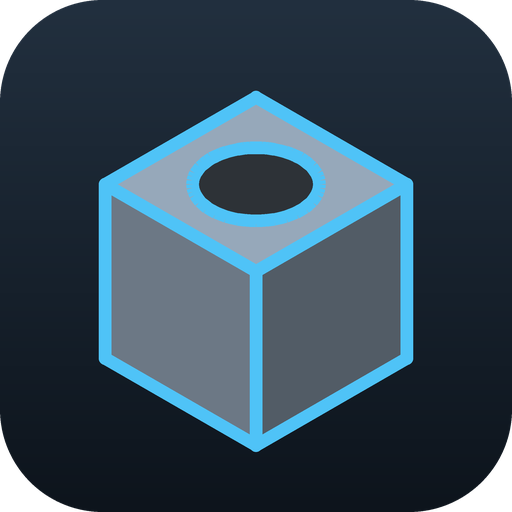
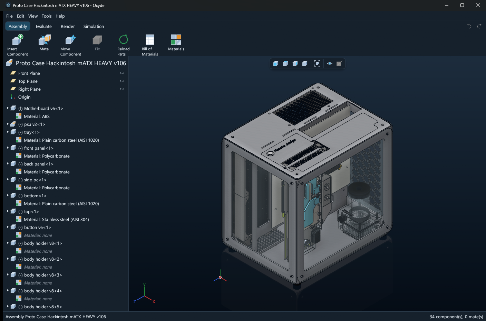
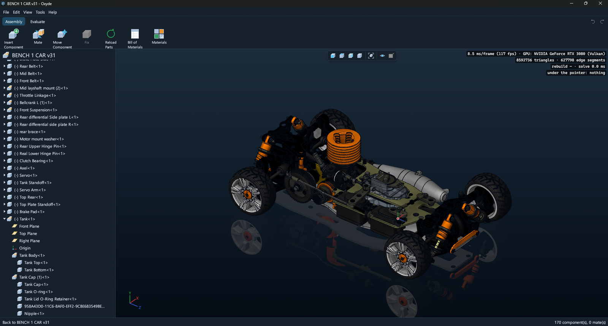
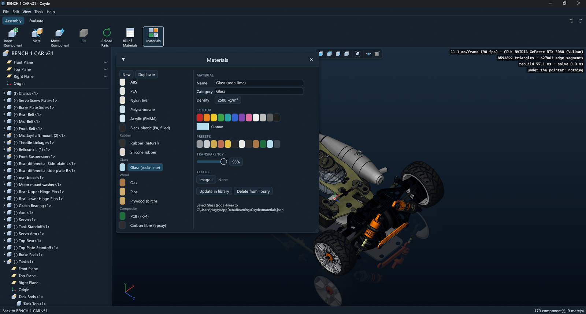

<p align="center">
  
</p>

<h1 align="center">Oxyde</h1>

<p align="center">
  <strong>An open-source parametric 3D CAD modeller, written in Rust on OpenCASCADE.</strong><br />
  Sketch, constrain and build solids on a feature timeline. Change a dimension and the part
  rebuilds. Assemble parts with mates, render them, simulate them, and keep every file open
  and documented.
</p>

<div align="center">

[![Download for Windows][badge-windows]][releases]
[![Download for macOS][badge-macos]][releases]

</div>

<p align="center">
  <a href="https://github.com/TheApache142857/Oxyde/releases">Download</a> ·
  <a href="CHANGELOG.md">What's new</a> ·
  <a href="docs/FORMAT.md">File formats</a> ·
  <a href="docs/BUILDING.md">Building</a> ·
  <a href="https://github.com/TheApache142857/Oxyde/issues">Report a bug</a>
</p>

<p align="center">
  <a href="https://github.com/TheApache142857/Oxyde/releases/latest"></a>
  <a href="https://github.com/TheApache142857/Oxyde/releases"></a>
  <a href="LICENSE"></a>
  <a href="https://github.com/TheApache142857/Oxyde/stargazers"></a>
</p>



*A micro-ATX computer case assembly in Oxyde: 34 components, each with its material in the tree.
The panels are clear polycarbonate, so the graphics card, the pump and the power supply show
through the steel frame.*

## Download

- **Windows 10/11 (x64):** run `Oxyde-Setup-<version>.exe` from the
  [latest release][releases]. It installs for your user only, no administrator rights needed.
  For every user of a machine, or for deployment tools, take the `.msi`; to run without
  installing, the `.zip`.
- **macOS 12+ (Apple silicon):** open `Oxyde-<version>-macos-arm64.dmg` and drag Oxyde into
  Applications.
- **Linux:** no package yet; [build from source](#build-and-run) with your distribution's
  OpenCASCADE.

The downloads aren't signed yet. On Windows, if SmartScreen warns you, choose **More info**, then
**Run anyway**. On macOS, the first time, right-click Oxyde in Applications and choose **Open**.

New to it? **File › Open demo bracket** loads a finished part to look around in.

**Status: pre-alpha, usable for real parts.** Oxyde moves fast and the file format can still
gain fields, though files written by older versions keep opening. Keep copies of what you care
about. Bugs and ideas are welcome in [Issues](https://github.com/TheApache142857/Oxyde/issues);
what changed in each version is in the [changelog](CHANGELOG.md).

## A look around

<table>
  <tr>
    <td width="50%"></td>
    <td width="50%"></td>
  </tr>
  <tr>
    <td><em>An RC car of 170 components and 8.6 million triangles, at 117 frames a second on an RTX 3080.</em></td>
    <td><em>The materials library: density for mass properties, colour, transparency and texture for the look.</em></td>
  </tr>
</table>

## What works

- **Sketches** on the standard planes, reference planes or flat faces: lines, rectangles,
  circles, centrepoint, three-point and tangent arcs, slots, polygons and points; construction
  geometry, sketch fillets and offsets, trim and extend, and Convert Entities from part edges.
- **Relations and dimensions** solved as you draw: coincident, horizontal, vertical, parallel,
  perpendicular, tangent, equal, collinear, concentric, fix and more; Smart Dimension for
  lengths, distances, angles, radii and diameters. Colours show what is fully defined, and
  conflicting or redundant relations are caught.
- **Features** on a parametric timeline with a rollback bar: extrude (blind, mid plane, through
  all, up to a surface) and revolve as a boss, a cut, an intersection or a new body; sweep,
  loft, fillet, chamfer, shell, the Hole Wizard (ISO clearance, tapped, counterbored and
  countersunk holes), linear and circular patterns, mirror, reference planes and axes, and
  multi-body parts. Every feature previews live before OK.
- **Stable references.** Faces and edges keep their names across rebuilds, so a fillet or a
  sketch on a face stays where it was when an earlier dimension changes. Dimensions have names
  too (`D1@Sketch1`).
- **Parameters and configurations:** global variables, equations
  (`"D1@Sketch1" = "Width" * 2`) and named variants of a part with their own dimensions and
  suppressed features. Every value field takes arithmetic with units: `80/2`, `3/8 in`, `45deg`.
- **Assemblies** (`.oxyasm`): parts and sub-assemblies, coincident, concentric, parallel,
  perpendicular, distance and angle mates with a live preview, components dragged while the mates
  hold, parts edited in place with the rest of the assembly ghosted around them, interference
  detection, and a bill of materials exported as CSV.
- **Seeing and measuring:** a GPU viewport with section views, appearances (colour,
  transparency, textures) and floor reflections; distances between faces and edges, centre
  distances between holes, diameters, and mass properties with the centre of mass.
- **Render tab:** a path tracer on the GPU or the CPU, with materials, studio or sky light, soft
  shadows and glass, saved as PNG.
- **Simulation tab:** static stress, frequency, thermal, transient thermal and thermal stress
  studies, with fixtures, loads and contacts between bodies, meshed into tetrahedra by Netgen;
  stress, displacement, factor of safety and temperature drawn on the model, the natural
  frequencies listed with their mass participation and each mode's shape drawn. Topology
  studies: the stiffest shape that keeps a share of the part's mass, with regions to keep, a
  thinnest member, symmetry planes and a mould's pull direction, shown as a smooth surface and
  exported as STL.
- **Generative Design tab:** shapes grown between the bodies to keep and the bodies to stay
  clear of, in parts and assemblies, as Fusion 360 grows them, or a single body redesigned
  from the faces to keep (its holes kept clear, the room limited along each axis), with
  warnings before a setup that would disappoint: the stiffest shape for a mass
  target or the lightest under a safety factor (and a displacement limit), with load cases,
  for several materials and ways of making it (unrestricted, additive without supports,
  2-axis cutting, milling, casting), an outcome for each, on the graphics card when there is
  one; compared on a plot of mass against stress or stiffness, shown iteration by iteration,
  exported as STL, OBJ or 3MF, or made a part (*Create Part*: a solid meeting the bodies
  kept on their faces, then checked on a mesh of its own against every load case).
  Gravity and remote masses weigh the shapes, a minimum natural frequency keeps them clear
  of what shakes them, and milling can reach from several sides.
- **Files and exchange:** `.oxyprt` parts and `.oxyasm` assemblies are ZIP archives of plain
  JSON, [documented](docs/FORMAT.md) so any script or tool can read them. STEP import of parts
  and whole assemblies, with their colours and materials, as a base to build on; export to STEP,
  IGES, STL, OBJ, 3MF, glTF and PNG.
- **Drawings:** front, top, right and isometric views with exact hidden lines, centre marks and
  a title block, on A4 to A0, as PDF, SVG or DXF at true size.
- **Command line** `oxyde-cli`: rebuild a part without a window, then measure, check, export,
  picture or draw it (see below).
- **MCP server** `oxyde-mcp`: an AI assistant such as Claude models parts and assemblies with
  Oxyde's own features, looks at them and compares them with a STEP file it is remodelling
  (see below).

## Build and run

Windows (x64, MSVC) is the main platform: Visual Studio 2022 with the C++ workload, Rust 1.85+
and OpenCASCADE 7.7+ (8.0 tested), through vcpkg. macOS (Apple silicon) builds with Homebrew's
OpenCASCADE, Linux with the OpenCASCADE 7.8 of Debian and Ubuntu. Full instructions, Netgen and
packaging: [docs/BUILDING.md](docs/BUILDING.md).

```sh
cargo run --release -p oxyde-app    # the application
cargo test --workspace              # unit and end-to-end tests
```

## Command line

`oxyde-cli` rebuilds a `.oxyprt` through OpenCASCADE without opening a window, for scripts and
continuous integration:

```sh
cargo run -p oxyde-cli -- eval part.oxyprt [--json]           # feature statuses; per body volume, area, centre of mass, bounds, face/edge/vertex counts
cargo run -p oxyde-cli -- check part.oxyprt --expect expected.json [--tol 1e-3]   # pass/fail table against expected measures
cargo run -p oxyde-cli -- export part.oxyprt --out part.step   # or part.stl (binary, mm)
cargo run -p oxyde-cli -- snapshot part.oxyprt --out part.png [--view iso|front|top|right] [--width 1024 --height 768]
cargo run -p oxyde-cli -- drawing part.oxyprt --out part.pdf [--sheet a4|a3|a2|a1|a0] [--third-angle] [--no-hidden]   # or .svg, .dxf (true size)
```

Exit code 1 when a feature failed to rebuild or a check did not pass, 2 when the command could not
run. `expected.json` holds any of `bodies`, `volume`, `area`, `centre_of_mass`, `bounds` (`min`,
`max`), `faces`, `edges`, `vertices`; counts must match exactly, volume and area within the
relative tolerance, coordinates within the tolerance times the part's size. `eval --json` writes
the same object the tests in `crates/oxyde-tests/tests/cli.rs` read back.

## MCP server

`oxyde-mcp` is a [Model Context Protocol](https://modelcontextprotocol.io) server: through it an
AI assistant builds parts feature by feature (fully defined sketches with SolidWorks-style
dimensions, extrusions, revolves, fillets, shells, patterns, mirrors, holes, lofts, sweeps,
equations), assembles them with mates, and checks its work with sections, probes, renders and a
comparison against a reference part or STEP file. Its files are ordinary `.oxyprt` and `.oxyasm`
files, to open and edit in the application. To use it from Claude Code, build it and register it,
with the OpenCASCADE DLLs on `PATH` as for the tests:

```sh
cargo build -p oxyde-mcp
claude mcp add oxyde -- C:/path/to/Oxyde/target/debug/oxyde-mcp.exe
```

`oxyde-mcp --tools` prints its tools and their arguments, and `oxyde-mcp --batch calls.jsonl`
runs tool calls from a file (one `{"tool": ..., "arguments": {...}}` per line) without a client.

## Architecture

Rust owns the application; C++ is only a thin shim around OpenCASCADE, behind a `Kernel` trait so
the geometry engine can be replaced. A part file holds its feature timeline, never a frozen
shape: geometry is rebuilt from it, the same way every time. The design rules are in
[docs/ARCHITECTURE.md](docs/ARCHITECTURE.md), the Render and Simulation tabs in
[docs/RENDERING.md](docs/RENDERING.md) and [docs/SIMULATION.md](docs/SIMULATION.md).

| Crate | Role |
|---|---|
| `oxyde-geom` | Math primitives: points, vectors, planes, transforms, tolerances |
| `oxyde-sketch` | 2D sketch entities and the geometric constraint solver (degrees of freedom, fully defined, redundant/conflicting) |
| `oxyde-kernel` | The `Kernel` trait: solid operations, topology queries, operation history, STEP I/O |
| `oxyde-occt` | `Kernel` implementation backed by OpenCASCADE through a small C++ shim (`cxx`) |
| `oxyde-model` | Feature tree, dependency graph, rebuild, persistent topological naming |
| `oxyde-assembly` | Assemblies: components, mates and the 3D mate solver, bill of materials |
| `oxyde-format` | Reading and writing `.oxyprt` parts and `.oxyasm` assemblies |
| `oxyde-render` | Viewport scene and camera; software renderer (GPU fallback and reference), pixel-exact picking; the Render tab's path tracer |
| `oxyde-sim` | Finite element simulation: tetrahedral meshing, static, frequency and thermal solvers, topology optimization, generative design on a grid of voxels, result plots; depends on no other crate |
| `oxyde-sim-gpu` | Generative design's solve on a graphics card: WGSL compute shaders through `wgpu`, the CPU's solve as fallback and reference |
| `oxyde-app` | Desktop application (egui and wgpu) |
| `oxyde-cli` | Headless command line: rebuild a part and measure, check, export, picture or draw it |
| `oxyde-mcp` | MCP server: an AI assistant models, inspects and compares parts and assemblies |
| `oxyde-tests` | End-to-end tests: the model driving OpenCASCADE |

## Licence

[MIT](LICENSE). The downloads also ship OpenCASCADE and Netgen (the Simulation tab's mesher),
both under the LGPL 2.1 and linked dynamically, so they can be replaced;
[packaging/THIRD-PARTY.txt](packaging/THIRD-PARTY.txt) gives the details and where their sources
are.

Oxyde is independent. It follows the conventions of feature-based CAD (feature names, dimension
names, select first and then run a command) and is not affiliated with or endorsed by any CAD
vendor.

[badge-windows]: https://img.shields.io/badge/Windows-Download-0078D6?style=for-the-badge&logo=data%3Aimage%2Fsvg%2Bxml%3Bbase64%2CPHN2ZyB4bWxucz0iaHR0cDovL3d3dy53My5vcmcvMjAwMC9zdmciIHZpZXdCb3g9IjAgMCAyNCAyNCIgZmlsbD0id2hpdGUiPjxwYXRoIGQ9Ik0yIDJoOS41djkuNUgyek0xMi41IDJIMjJ2OS41aC05LjV6TTIgMTIuNWg5LjVWMjJIMnpNMTIuNSAxMi41SDIyVjIyaC05LjV6Ii8%2BPC9zdmc%2B
[badge-macos]: https://img.shields.io/badge/macOS-Download-333333?style=for-the-badge&logo=apple&logoColor=white
[releases]: https://github.com/TheApache142857/Oxyde/releases/latest
