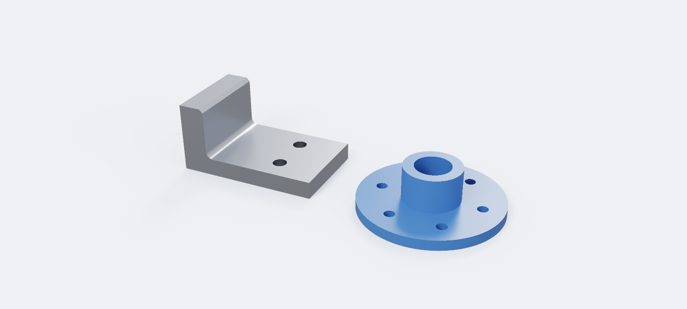

# Oxyde

**An open-source parametric 3D CAD modeller in the manner of SolidWorks**, written in Rust on the
[OpenCASCADE](https://dev.opencascade.org/) geometry kernel. Sketch, constrain, extrude, fillet,
assemble, render and simulate, with every part saved as an open, documented file.



> **Pre-alpha.** Oxyde is young and moves fast. It is usable for real parts, but expect rough
> edges, and keep copies of files you care about. Bug reports are welcome in
> [Issues](https://github.com/TheApache142857/Oxyde/issues).

## Download

Installers for Windows and macOS are on the [Releases](https://github.com/TheApache142857/Oxyde/releases) page.

| Platform | File |
|---|---|
| Windows 10/11 (x64) | `Oxyde-Setup-<version>.exe` installs for your user only, no administrator rights needed. `Oxyde-<version>-windows-x64.msi` installs for every user, for IT departments. The `.zip` runs without installing. |
| macOS 12+ (Apple Silicon) | `Oxyde-<version>-macos-arm64.dmg`: drag Oxyde to Applications. |
| Linux | No package yet: [build from source](#building-from-source). |

The builds are not code-signed yet. On Windows, SmartScreen may warn about an unrecognised app:
choose *More info* › *Run anyway*. On macOS, the first launch is refused as from an unidentified
developer: right-click Oxyde in Applications and choose *Open*.

New to it? *File › Open demo bracket* loads a finished part to look around in.

## What it does

If you know SolidWorks, you know where things are: the same feature names (`Sketch1`,
`Boss-Extrude1`, `Fillet1`), the same dimension names (`D1@Sketch1`), select first and then run
the command, and a PropertyManager panel with a live preview, OK and Cancel.

**Parts**
- A feature tree with a rollback bar: change a dimension or edit a feature, and everything
  after it rebuilds. Faces and edges keep their names across rebuilds, so fillets and
  sketches on faces stay where they were.
- Extrude (blind, mid plane, through all, up to a surface) and revolve, as a boss, a cut, an
  intersection or a new body; sweep, loft, fillet, chamfer, shell, the Hole Wizard (ISO
  clearance, tapped, counterbored and countersunk holes), linear and circular patterns, mirror,
  reference planes and axes, multi-body parts.
- Global variables, equations (`"D1@Sketch1" = "Width" * 2`) and configurations, each with its
  own dimensions and suppressed features.
- Values typed as arithmetic with units: `80/2`, `3/8 in`, `45deg`.

**Sketches**
- Lines, arcs, circles, slots and polygons, sketch fillets and offsets, and Convert Entities
  from part edges.
- A constraint solver: relations, Smart Dimension (lengths, angles, radii, diameters), snapping,
  trim and extend, and colours showing what is fully defined.

**Assemblies** (`.oxyasm`)
- Insert parts and sub-assemblies; coincident, concentric, parallel, perpendicular, distance and
  angle mates with a live preview; drag free components while mates hold.
- Edit parts in place with the rest ghosted around them, interference detection, and a bill of
  materials exported as CSV.

**Seeing and checking**
- A GPU viewport with section views, appearances (colours, transparency, textures) and measuring:
  distances, centre distances, diameters, mass properties.
- A **Render** tab: a path tracer on the GPU or the CPU, with materials, environment light, soft
  shadows and glass, saved as PNG.
- A **Simulation** tab: static stress, thermal, transient thermal and thermal stress studies, as
  in SolidWorks Simulation and Fusion 360. Fixtures, loads and contacts; meshed with Netgen;
  stress, displacement, factor of safety and temperature drawn on the model.

**Exchange**
- Import STEP parts and assemblies (with the colours and materials SolidWorks and Fusion 360
  write) and build on them.
- Export STEP, IGES, STL, OBJ, 3MF, glTF and PNG.
- Drawings: front, top, right and isometric views with hidden lines and a title block, as PDF,
  SVG or DXF at true size.

## Why Oxyde

- **Open files.** `.oxyprt` parts and `.oxyasm` assemblies are ZIP archives of plain JSON,
  documented in [`docs/FORMAT.md`](docs/FORMAT.md). A script, a viewer or a BOM tool can read them
  without Oxyde installed.
- **The model is the timeline.** A part file holds the features that make it, not a frozen
  shape: it rebuilds the same way every time.
- **Interoperability through open standards**, STEP first. Oxyde does not read or write
  SolidWorks or other proprietary files.
- **A replaceable kernel.** OpenCASCADE sits behind a Rust trait, so the geometry engine can
  change without rewriting the rest.

## Building from source

Windows (x64, MSVC) is the main platform: Visual Studio 2022 with the C++ workload, Rust 1.85+
and OpenCASCADE 7.7+ (8.0 tested), through vcpkg. macOS (Apple Silicon) builds with Homebrew's
OpenCASCADE, Linux with the OpenCASCADE 7.8 of Debian and Ubuntu. The full instructions,
including Netgen and packaging, are in [`docs/BUILDING.md`](docs/BUILDING.md).

```powershell
cargo run --release -p oxyde-app    # the application
cargo test --workspace              # unit and end-to-end tests
```

## Command line

`oxyde-cli` rebuilds a `.oxyprt` through OpenCASCADE without opening a window, for scripts and
continuous integration:

```powershell
cargo run -p oxyde-cli -- eval part.oxyprt [--json]           # feature statuses; per body volume, area, centre of mass, bounds, face/edge/vertex counts
cargo run -p oxyde-cli -- check part.oxyprt --expect expected.json [--tol 1e-3]   # pass/fail table against expected measures
cargo run -p oxyde-cli -- export part.oxyprt --out part.step   # or part.stl (binary, mm)
cargo run -p oxyde-cli -- snapshot part.oxyprt --out part.png [--view iso|front|top|right] [--width 1024 --height 768]
cargo run -p oxyde-cli -- drawing part.oxyprt --out part.pdf [--sheet a4|a3|a2|a1|a0] [--third-angle] [--no-hidden]   # or .svg, .dxf (true size)
```

Exit code 1 when a feature failed to rebuild or a check did not pass, 2 when the command could not
run. `expected.json` holds any of `bodies`, `volume`, `area`, `centre_of_mass`, `bounds` (`min`,
`max`), `faces`, `edges`, `vertices`; counts must match exactly, volume and area within the
relative tolerance, coordinates within the tolerance times the part's size. `eval --json` writes
the same object the tests in `crates/oxyde-tests/tests/cli.rs` read back.

## How it is built

Rust owns the application; C++ is only a thin shim around OpenCASCADE. The design decisions and
rules are in [`docs/ARCHITECTURE.md`](docs/ARCHITECTURE.md), the Render and Simulation tabs in
[`docs/RENDERING.md`](docs/RENDERING.md) and [`docs/SIMULATION.md`](docs/SIMULATION.md), and what
changed recently in [`CHANGELOG.md`](CHANGELOG.md).

```
            oxyde-app
            /    |    \
 oxyde-format    |    oxyde-occt ── C++ shim ── OpenCASCADE
      |     \    |    /
      |   oxyde-assembly
      |      /
           oxyde-model
            /        \
  oxyde-sketch     oxyde-kernel (trait)
            \        /
            oxyde-geom
```

| Crate | Role |
|---|---|
| `oxyde-geom` | Math primitives: points, vectors, planes, transforms, tolerances |
| `oxyde-sketch` | 2D sketch entities and the geometric constraint solver (degrees of freedom, fully defined, redundant/conflicting) |
| `oxyde-kernel` | The `Kernel` trait: solid operations, topology queries, operation history, STEP I/O |
| `oxyde-occt` | `Kernel` implementation backed by OpenCASCADE through a small C++ shim (`cxx`) |
| `oxyde-model` | Feature tree, dependency graph, rebuild, persistent topological naming |
| `oxyde-assembly` | Assemblies: components, mates and the 3D mate solver, bill of materials |
| `oxyde-format` | Reading and writing `.oxyprt` parts and `.oxyasm` assemblies |
| `oxyde-render` | Viewport scene and camera; software renderer (GPU fallback and reference), pixel-exact picking; path tracer for the Render tab (the application runs the same one on the GPU) |
| `oxyde-app` | Desktop application (UI and viewport) |
| `oxyde-sim` | Finite element simulation: a tetrahedral mesher for closed triangle meshes, linear static and thermal solvers, result plots in colour bands; depends on no other crate |
| `oxyde-cli` | Headless command line: rebuild a part and measure, check, export, picture or draw it |
| `oxyde-tests` | End-to-end tests: the model driving OpenCASCADE |

## License

Oxyde is [MIT](LICENSE)-licensed. The installers also ship OpenCASCADE and Netgen (the
Simulation tab's mesher), both under the LGPL 2.1 and linked dynamically, so they can be
replaced; [`packaging/THIRD-PARTY.txt`](packaging/THIRD-PARTY.txt) gives the details and where
their sources are.
